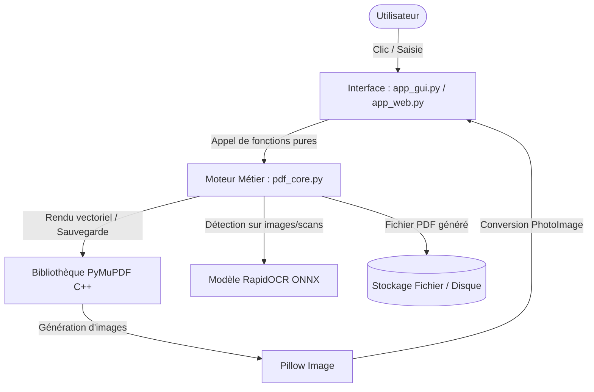
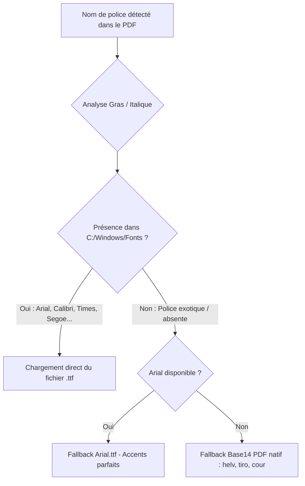

# 📘 Spécification Technique et Guide de Conception Complet - PDF Studio Express

Ce document détaille **l'intégralité de l'architecture, du fonctionnement technique, des choix de conception (UI/UX) et des algorithmes** de PDF Studio Express. Il est rédigé pour permettre à n'importe quel ingénieur ou développeur de comprendre, d'auditer ou de **reconstruire le projet de zéro** sans aucune ambiguïté.

---

## 📑 Sommaire

1. [Vue d'Ensemble & Philosophie du Projet](#1-vue-densemble--philosophie-du-projet)
2. [Choix Technologiques & Justifications](#2-choix-technologiques--justifications)
3. [Architecture Générale du Système](#3-architecture-générale-du-système)
4. [Arborescence & Rôle des Fichiers](#4-arborescence--rôle-des-fichiers)
5. [Spécifications Détaillées du Moteur (`pdf_core.py`)](#5-spécifications-détaillées-du-moteur-pdf_corepy)
   - [Structures de Données Clés](#structures-de-données-clés)
   - [Gestion de la Typographie & Polices](#gestion-de-la-typographie--polices)
   - [Algorithme d'Édition Vectorielle de Texte](#algorithme-dédition-vectorielle-de-texte)
   - [Moteur OCR & Remplacement sur Documents Scannés](#moteur-ocr--remplacement-sur-documents-scannés)
   - [Manipulation de Pages & Réorganisation](#manipulation-de-pages--réorganisation)
   - [Filigranage & Numérotation Dynamique](#filigranage--numérotation-dynamique)
   - [Cryptographie & Chiffrement AES-256](#cryptographie--chiffrement-aes-256)
   - [Optimisation & Compression des Flux](#optimisation--compression-des-flux)
6. [Spécifications Design & Ergonomie Desktop (`app_gui.py`)](#6-spécifications-design--ergonomie-desktop-app_guipy)
   - [Palette Graphique & Système de Design](#palette-graphique--système-de-design)
   - [Disposition & Agencement Responsive](#disposition--agencement-responsive)
   - [Calcul Dynamique de la Grille de Miniatures](#calcul-dynamique-de-la-grille-de-miniatures)
   - [Gestion du Cycle de Vie & Mémoire](#gestion-du-cycle-de-vie--mémoire)
7. [Spécifications de l'Interface Web (`app_web.py`)](#7-spécifications-de-linterface-web-app_webpy)
8. [Scripts d'Amorçage & Portabilité Windows](#8-scripts-damorçage--portabilité-windows)
9. [Guide de Reconstruction Pas-à-Pas (De Zéro)](#9-guide-de-reconstruction-pas-à-pas-de-zéro)
10. [Cas d'Usage Limites & Robustesse](#10-cas-dusage-limites--robustesse)

---

## 1. Vue d'Ensemble & Philosophie du Projet

### Problématique
La plupart des logiciels de modification de PDF existants souffrent de défauts majeurs :
- **Outils en ligne (SaaS)** : posent de graves problèmes de confidentialité (les documents bancaires, fiches de paie ou contrats sont téléversés sur des serveurs tiers).
- **Logiciels propriétaires (ex: Adobe Acrobat)** : très lourds, coûteux (abonnements mensuels) et complexes pour des besoins simples.
- **Outils gratuits classiques** : souvent remplis de publicités, bridés ou incapables de modifier du texte en conservant la typographie d'origine.

### Principes Directeurs
1. **100% Hors-Ligne & Zéro Télémétrie** : Aucun document, aucune métadonnée et aucun pixel ne quitte l'ordinateur de l'utilisateur.
2. **Double Interface** : Une interface de bureau native ultra-rapide (Tkinter) et une interface web conviviale (Streamlit), partageant le même moteur sous-jacent.
3. **Modification Intelligente de Texte** : Capacité à modifier du texte vectoriel ou scanné (OCR) en reproduisant la police, la taille et la couleur.
4. **Portabilité Totale sous Windows** : Démarrage en 1 clic sans nécessiter de configuration manuelle des variables d'environnement.

---

## 2. Choix Technologiques & Justifications

```
+-------------------------------------------------------------+
|                     PDF STUDIO EXPRESS                      |
+-------------------------------------------------------------+
               |                               |
    [ Interface Bureau ]              [ Interface Web ]
      Tkinter + ttk                     Streamlit
               \                               /
                \                             /
         +-------------------------------------------+
         |           pdf_core.py (Moteur)            |
         +-------------------------------------------+
               |                               |
        [ PyMuPDF / fitz ]            [ RapidOCR / ONNX ]
     Manipulation C++ native          Inférence locale CPU
```

### 1. Langage : Python 3.10+
- **Raison** : Richesse de l'écosystème de traitement de documents et facilité de portage.

### 2. Moteur PDF : `PyMuPDF` (Bindings Python de MuPDF en C++)
- **Pourquoi pas `pypdf` ?** `pypdf` est lent sur les documents volumineux, incapable d'effectuer un rendu graphique rapide (rasterisation) et limité sur la manipulation de bas niveau du texte vectoriel.
- **Pourquoi PyMuPDF ?** C'est le moteur le plus rapide au monde (écrit en C), gérant le rendu graphique à haute résolution, la rédaction sans perte (`redact annotations`), la déflation de flux et le chiffrement AES-256.

### 3. Moteur OCR : `RapidOCR` avec runtime ONNX
- **Pourquoi pas `pytesseract` (Tesseract OCR) ?** Tesseract nécessite l'installation d'un binaire lourd système (`tesseract.exe`), de variables d'environnement et de fichiers de langues tiers (`tessdata`).
- **Pourquoi RapidOCR ?** Il est auto-contenu en Python, embarque des modèles ONNX pré-entraînés exécutés sur le processeur (CPU), offre une précision supérieure sur les lignes inclinées et ne nécessite aucune installation de logiciel externe.

### 4. Interface Desktop : `tkinter` + `ttk` moderne
- **Raison** : Présent nativement dans toutes les distributions Python sous Windows. Aucun temps de compilation, démarrage instantané en moins de 0.5 seconde et zéro dépendance C++ lourde (contrairement à PyQt/PySide de plusieurs centaines de Mo).

### 5. Interface Web : `streamlit`
- **Raison** : Permet une interface web réactive immédiate avec glisser-déposer de fichiers, prévisualisation interactive et téléchargement zippé.

---

## 3. Architecture Générale du Système

Le projet suit le patron architectural **Modèle-Vue (MV)** découplé :



- **Couche Modèle / Moteur (`pdf_core.py`)** : Fonctions pures, indépendantes de l'interface graphique. Elles prennent des chemins de fichiers, des flux ou des coordonnées, et renvoient des structures sérialisables ou écrivent sur disque.
- **Couche Présentation Bureau (`app_gui.py`)** : Gère les widgets Tkinter, les événements souris/clavier, la réactivité de la grille de vignettes et le cycle de vie des fenêtres.
- **Couche Présentation Web (`app_web.py`)** : Gère l'état de session (`st.session_state`), les téléversements multi-fichiers et les archives ZIP.

---

## 4. Arborescence & Rôle des Fichiers

```text
editeur-pdf/
│
├── pdf_core.py                 # Moteur principal de manipulation PDF et OCR
├── app_gui.py                  # Application de bureau native Windows (Tkinter)
├── app_web.py                  # Interface web alternative (Streamlit)
│
├── creer_exemple.py            # Script utilitaire de génération du PDF de test
├── exemple_document.pdf        # Document PDF de démonstration (5 pages types)
│
├── Lancer_Editeur_PDF.bat      # Script batch de démarrage bureau (détection dynamique)
├── Lancer_Silencieux.vbs       # Lanceur VBScript sans invite de commande noire
├── Lancer_Version_Web.bat      # Script batch de lancement du serveur Streamlit
│
├── requirements.txt            # Dépendances logicielles normalisées
├── .gitignore                  # Règles d'exclusion Git (caches, logs, audits privés)
├── README.md                   # Documentation utilisateur du dépôt
├── SECURITY.md                 # Politique de sécurité et guide pour auditeurs externes
└── AUDIT_SECURITE_LOCAL.md     # Rapport d'audit de sécurité complet (local uniquement)
```

---

## 5. Spécifications Détaillées du Moteur (`pdf_core.py`)

### Structures de Données Clés

#### 1. Configuration de réorganisation de page (`page_configs`)
```python
[
    {
        "source_page": 2,    # Index 0-based de la page dans le document source
        "rotation": 90       # Rotation supplémentaire relative (0, 90, 180, 270)
    },
    ...
]
```

#### 2. Élément de texte détecté (`text_elements`)
```python
{
    "id": 0,                           # Identifiant unique de l'élément sur la page
    "text": "Facture N° 2026-0042",    # Texte brut extrait
    "font": "Helvetica",               # Nom de la police originale
    "size": 13.0,                      # Taille de police en points typographiques
    "flags": 0,                        # Drapeaux de style (bit 1: italique, bit 4: gras)
    "color_rgb": (0.1, 0.1, 0.1),      # Couleur en tuple RGB normalisé (0.0 à 1.0)
    "color_hex": "#1A1A1A",            # Code hexadécimal pour l'affichage UI
    "bbox": [50.0, 119.9, 178.0, 137.8], # Bounding box [x0, y0, x1, y1] en points PDF
    "origin": [50.0, 133.9],           # Coordonnées (x, y) de la ligne de base d'écriture
    "is_ocr": False                    # True si issu de la détection optique, False si vectoriel
}
```

---

### Gestion de la Typographie & Polices

Le système utilise une table de correspondance dynamique pour associer les noms de polices PDF aux polices TrueType système de Windows (`C:/Windows/Fonts/`) :



#### Table de Résolution Typographique :
- **Sans-Serif (Arial, Helvetica, Univers)** : `arial.ttf` / `arialbd.ttf` (Gras) / `ariali.ttf` (Italique).
- **Serif (Times, Roman, Georgia)** : `times.ttf` / `timesbd.ttf` / `timesi.ttf`.
- **Monospace (Courier, Consolas, Code)** : `cour.ttf` / `consola.ttf`.
- **Interface (Segoe UI, Tahoma)** : `segoeui.ttf` / `tahoma.ttf`.

---

### Algorithme d'Édition Vectorielle de Texte

Pour remplacer du texte vectoriel dans un PDF sans altérer le reste du document :

1. **Localisation du rectangle englobant (`bbox`)** :
   Calculé à partir du `span` ou de la ligne sélectionnée via `page.get_text("dict")`.
2. **Rédaction vectorielle (`add_redact_annot`)** :
   ```python
   # Si use_white_bg est False, le rectangle de rédaction n'a pas de couleur de fond.
   # Il supprime les instructions vectorielles de tracé de caractères du flux PDF
   # tout en préservant le fond (image de fond, bandeau coloré, etc.).
   annot = page.add_redact_annot(rect)
   page.apply_redactions()
   ```
3. **Réinsertion textuelle précise (`insert_text`)** :
   ```python
   # Le texte est injecté précisément aux coordonnées de ligne de base (origin)
   page.insert_text(
       origin,
       new_text,
       fontsize=font_size,
       color=font_color,
       **font_kwargs
   )
   ```

---

### Moteur OCR & Remplacement sur Documents Scannés

Quand un PDF provient d'un scan ou d'une image (ex: facture scannée), il contient **0 élément vectoriel**. L'algorithme bascule automatiquement en mode OCR :

```
Page PDF (Scannée)
       |
       v
[ get_pixmap(dpi=150) ] -> Rendu bitmap en mémoire vive
       |
       v
[ RapidOCR Engine ] ------> Détection des boîtes polygonales & texte
       |
       v
Mise à l'échelle : scale = 150 / 72.0 (Conversion Pixels -> Points PDF)
       |
       v
Boîtes de texte avec coordonnées précises [x0, y0, x1, y1]
```

#### Remplacement sur Document Scanné :
1. Calcul du rectangle de masquage : `pad_rect = fitz.Rect(x0 - 2, y0 - 1, x1 + 2, y1 + 1)`.
2. Masquage opaque : `page.draw_rect(pad_rect, color=(1, 1, 1), fill=(1, 1, 1))` recouvre les pixels du document scanné.
3. Écriture par-dessus : injection du texte avec police lissée aux coordonnées calculées.

---

### Manipulation de Pages & Réorganisation

La fonction `save_modified_pdf` reconstruit un nouveau document cible en une seule passe :
```python
out_doc = fitz.open()
for conf in page_configs:
    idx = conf["source_page"]
    rot = conf.get("rotation", 0) % 360
    
    # Insertion de la page originale
    out_doc.insert_pdf(src_doc, from_page=idx, to_page=idx)
    new_idx = len(out_doc) - 1
    
    # Application de la rotation relative
    if rot != 0:
        current_rot = out_doc[new_idx].rotation
        out_doc[new_idx].set_rotation((current_rot + rot) % 360)

# Sauvegarde optimisée
out_doc.save(output_path, garbage=4, deflate=True)
```

---

### Filigranage & Numérotation Dynamique

- **Filigrane textuel** :
  - Calcul de la taille du texte : `text_len = fitz.get_text_length(text, fontsize)`.
  - Centrage géométrique : point d'ancrage `(rect.width/2 - text_len/2, rect.height/2)`.
  - Rotation angulaire par transformation affine : `morph = (center, fitz.Matrix(angle))`.
- **Numérotation des pages** :
  - Remplacement dynamique des balises `{page}` (page actuelle) et `{total}` (nombre total de pages).
  - 5 positions supportées : `bottom-center`, `bottom-right`, `bottom-left`, `top-center`, `top-right`.

---

### Cryptographie & Chiffrement AES-256

- **Chiffrement** :
  ```python
  doc.save(
      output_path,
      encryption=fitz.PDF_ENCRYPT_AES_256,
      user_pw=password,
      owner_pw=password
  )
  ```
  Le chiffrement AES-256 protège l'intégralité du flux, des métadonnées et des pièces jointes.
- **Déverrouillage** :
  L'authentification valide le mot de passe (`doc.authenticate(password) > 0`). Si valide, la sauvegarde sans paramètre d'encryption produit un PDF déchiffré.

---

### Optimisation & Compression des Flux

La sauvegarde utilise les drapeaux MuPDF avancés :
- `garbage=4` : Recherche et suppression de tous les objets non référencés, fusion des doublons et réorganisation de la table XREF.
- `deflate=True` : Compression zlib des flux de contenu non compressés.
- `clean=True` : Nettoyage et normalisation de la syntaxe interne des opérateurs PDF.

---

## 6. Spécifications Design & Ergonomie Desktop (`app_gui.py`)

### Palette Graphique & Système de Design

L'interface adopte une esthétique moderne basée sur la palette **Tailwind Slate** :

| Nom | Code Hex | Utilisation |
| :--- | :--- | :--- |
| **Fond Principal** | `#f8fafc` | Arrière-plan de la zone de travail |
| **Barre Latérale** | `#0f172a` | Fond sombre de navigation |
| **Bouton Sidebar (Inactif)** | `#1e293b` | Onglets inactifs |
| **Bouton Sidebar (Actif)** | `#2563eb` | Onglet sélectionné (Bleu primaire) |
| **Bouton Hover** | `#334155` | Survol de souris |
| **Cartes Vignettes** | `#ffffff` | Fond blanc des vignettes de pages |
| **Sélection Carte** | `#dbeafe` | Bleu pastel indiquant la sélection |
| **Bordure Active** | `#2563eb` | Encadrement des éléments sélectionnés |
| **Succès (Enregistrer)** | `#16a34a` | Boutons d'action positive / sauvegarde |
| **Danger (Supprimer)** | `#dc2626` | Boutons de suppression |
| **Texte Principal** | `#0f172a` | Titres et labels |
| **Texte Secondaire** | `#64748b` | Sous-titres et métadonnées |

---

### Calcul Dynamique de la Grille de Miniatures

Pour que la grille de pages s'adapte automatiquement à toutes les résolutions d'écran sans défilement horizontal :

$$\text{colonnes} = \max\left(1, \; \left\lfloor \frac{\text{largeur\_canvas}}{\text{largeur\_carte} + \text{marge}} \right\rfloor \right)$$

Avec :
- $\text{largeur\_carte} = 180\text{ px}$
- $\text{marge} = 16\text{ px}$
- À chaque redimensionnement (`<Configure>`), la disposition en grille (`grid(row, col)`) est recalculée instantanément.

---

### Gestion du Cycle de Vie & Mémoire

1. **Cycle des images PhotoImage** :
   Tkinter nécessite de maintenir une référence Python active sur chaque objet `ImageTk.PhotoImage` pour éviter que le ramasse-miettes (`garbage collector`) ne détruise l'image en mémoire. Elles sont stockées dans le dictionnaire `pages_data[i]["tk_thumb"]`.
2. **Nettoyage à la fermeture** :
   ```python
   self.protocol("WM_DELETE_WINDOW", self._on_app_closing)
   ```
   Détruit immédiatement tout fichier temporaire résiduel présent dans `%TEMP%`.

---

## 7. Spécifications de l'Interface Web (`app_web.py`)

L'interface web Streamlit propose une architecture réactive par onglets :
- `st.set_page_config` : Pleine largeur (`layout="wide"`) avec icône personnalisée.
- `st.session_state` : Mémorise l'état du document (`pages_order`, `pages_rotation`, `te_file_bytes`) lors des interactions utilisateur pour éviter la perte d'état entre les rechargements.
- `zipfile.ZipFile` en mémoire (`io.BytesIO`) : Permet le téléchargement en 1 clic de lots d'images ou de pages découpées sans toucher au disque dur.

---

## 8. Scripts d'Amorçage & Portabilité Windows

Pour garantir un lancement direct sur n'importe quel ordinateur sans configuration :

### 1. `Lancer_Editeur_PDF.bat`
Recherche hiérarchique de l'exécutable Python :
1. `%LOCALAPPDATA%\Python\bin\python.exe`
2. `%LOCALAPPDATA%\Programs\Python\Python314\python.exe`
3. `%LOCALAPPDATA%\Programs\Python\Python313\python.exe`
4. `%LOCALAPPDATA%\Programs\Python\Python312\python.exe`
5. Commande globale `py`
6. Commande globale `python`

### 2. `Lancer_Silencieux.vbs`
Utilise `WScript.Shell.Run` avec le paramètre `0` pour masquer complètement la console noire Windows :
```vbscript
objShell.Run Chr(34) & pythonwPath & Chr(34) & " " & Chr(34) & appScript & Chr(34), 0, False
```

---

## 9. Guide de Reconstruction Pas-à-Pas (De Zéro)

Pour recréer ce logiciel à partir d'un système vierge :

### Étape 1 : Initialisation de l'environnement
```bash
# 1. Cloner ou créer le dossier
mkdir editeur-pdf && cd editeur-pdf

# 2. Créer l'environnement virtuel (optionnel mais recommandé)
python -m venv venv
venv\Scripts\activate

# 3. Installer les dépendances
pip install PyMuPDF Pillow rapidocr-onnxruntime streamlit fpdf2
```

### Étape 2 : Implémenter `pdf_core.py`
1. Écrire les fonctions d'information et d'inspection (`get_pdf_info`).
2. Implémenter le rendu de vignettes (`render_all_thumbnails`).
3. Écrire le moteur de manipulation de pages (`save_modified_pdf`, `merge_pdfs`, `split_*`).
4. Implémenter la détection de polices Windows et le remplacement de texte (`get_page_text_elements`, `replace_text_element_in_pdf`, `search_and_replace_text_in_pdf`).
5. Intégrer l'inférence OCR via `RapidOCR` pour la prise en charge des documents scannés.
6. Ajouter le chiffrement AES-256 (`protect_pdf`, `unlock_pdf`).

### Étape 3 : Implémenter `app_gui.py`
1. Créer la classe principale héritant de `tk.Tk`.
2. Définir le thème TTK, les polices Segoe UI et les couleurs Slate.
3. Construire la barre latérale et le conteneur de vues (`show_tab`).
4. Construire l'organiseur visuel avec canvas défilant et cartes interactives.
5. Construire l'onglet d'édition de texte avec liste synchronisée et formulaire de remplacement.
6. Construire les onglets de fusion, découpage, filigrane et sécurité.
7. Ajouter la gestion du protocole `WM_DELETE_WINDOW` pour le nettoyage des fichiers temporaires.

### Étape 4 : Implémenter `app_web.py`
1. Implémenter la barre latérale de sélection de modules.
2. Implémenter les `file_uploader` et boutons de téléchargement Streamlit.
3. Relier chaque action aux fonctions de `pdf_core.py`.

### Étape 5 : Créer les lanceurs et tester
1. Rédiger les scripts `.bat` et `.vbs`.
2. Générer le document d'exemple avec `creer_exemple.py`.
3. Valider l'ensemble avec des tests fonctionnels et de sécurité (`bandit`, `pip-audit`).

---

## 10. Cas d'Usage Limites & Robustesse

| Scénario testé | Comportement du système |
| :--- | :--- |
| **PDF protégé par mot de passe** | Détection automatique à l'ouverture, affichage d'une boîte de dialogue modale de déverrouillage. |
| **Document 100% scanné (Image pure)** | Bascule transparente et automatique vers le moteur RapidOCR ; coordonnées et textes extraits sans intervention manuelle. |
| **PDF avec polices non standards / exotiques** | Détection des attributs (gras/italique) et bascule propre vers Arial TrueType pour préserver la lisibilité et les accents français. |
| **Remplacement avec texte plus long/court** | Masquage complet de la boîte d'origine (pas de résidu de lettres) et réécriture vectorielle propre. |
| **Fermeture brutale de l'application** | Gestionnaire d'arrêt capturant l'événement pour purger les fichiers de travail dans `%TEMP%`. |
| **Absence totale de connexion Internet** | Fonctionnement 100% identique : aucun composant ne nécessite d'accès au réseau. |

---

*Document de spécification technique rédigé pour PDF Studio Express.*
